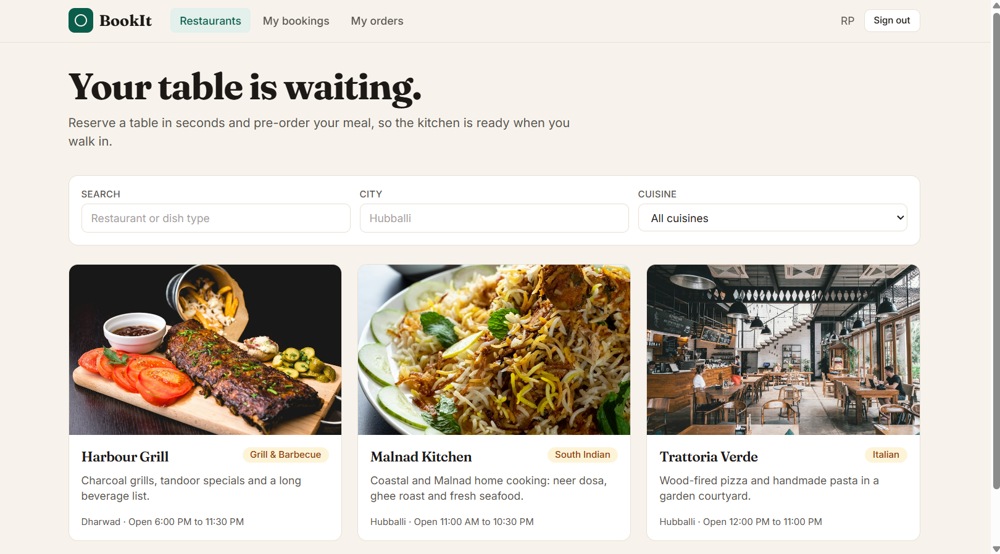
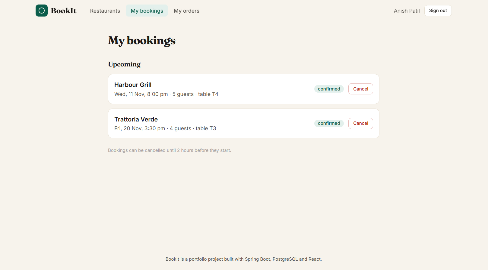
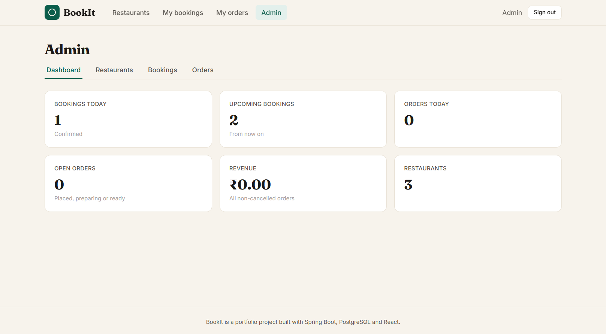
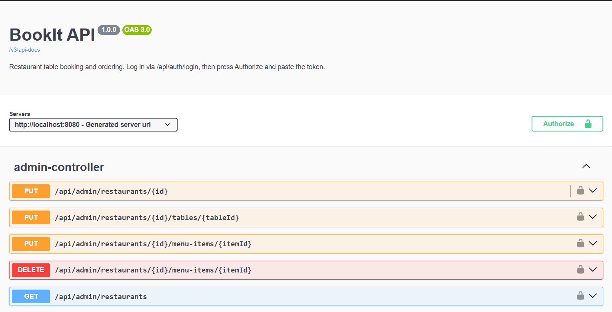
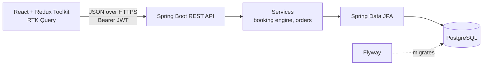
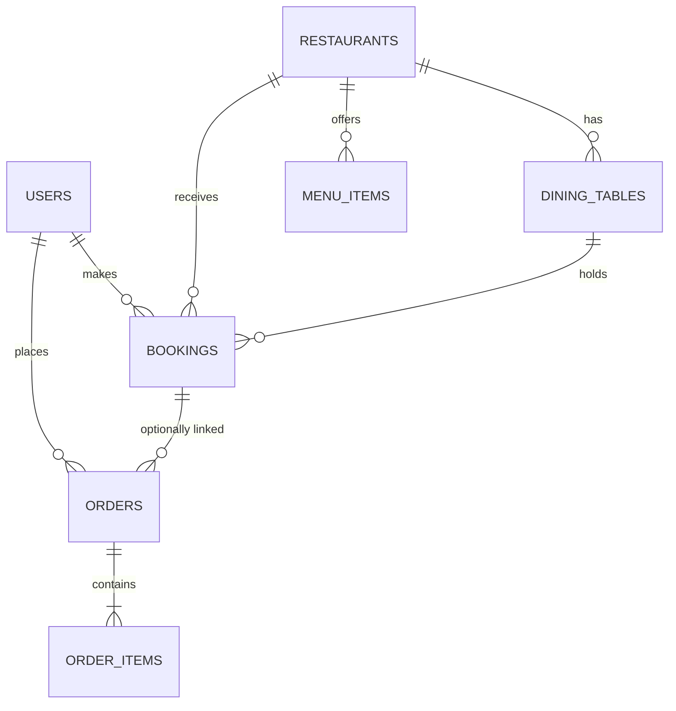

# BookIt

A restaurant table-booking and pre-ordering platform. Customers search restaurants, see live availability, reserve a table, and pre-order dishes. Admins manage restaurants, tables and menus, and run the kitchen queue.


**Live demo:** _add your Vercel link_ &nbsp;|&nbsp; **API docs (Swagger):** _add your Render link_`/swagger-ui.html`

> Demo logins (seeded on first start): customer `demo@bookit.dev` / `Demo@12345`, admin `admin@bookit.dev` / `Admin@12345`.

## Screenshots

### Browse restaurants


### Live availability and booking
Slots that are already taken are crossed out.



### Admin: kitchen queue and dashboard


### API documentation (Swagger UI)


## What makes it more than a CRUD app

- **Double-booking is impossible, and there is a test that proves it.** Bookings take a row lock on the restaurant (`SELECT ... FOR UPDATE`), re-check overlaps inside the lock, and on PostgreSQL a database **exclusion constraint** (`EXCLUDE USING gist`) rejects overlapping confirmed bookings even if application code is bypassed. `BookingConcurrencyTest` fires 8 simultaneous requests at one table and asserts exactly one wins.
- **Smart table assignment.** Guests get the smallest free table that fits their party, so large tables stay available for large groups.
- **Server-authoritative orders.** Totals are computed on the server from current menu prices; each line stores a snapshot of name and price, so later menu edits never rewrite history.
- **A real state machine for the kitchen.** `PLACED -> PREPARING -> READY -> SERVED`, with cancellation only before `READY`. Illegal jumps return `400`.
- **Security done properly.** Stateless JWT, BCrypt, role-based access (`CUSTOMER` / `ADMIN`) enforced on the server, the user is re-loaded from the database on every request (role changes and deleted accounts take effect immediately), and ownership checks return `404` rather than leaking that someone else's record exists.
- **Production habits.** Flyway migrations (Hibernate only validates), RFC 7807 error responses, optimistic locking (`@Version`), pagination, typed configuration, health endpoint, OpenAPI docs, Docker, CI.

## Architecture





Layers: `web` (controllers, thin) -> `service` (rules and transactions) -> `repository` (Spring Data) -> `domain` (JPA entities). Controllers never expose entities; they return DTO records.

## Tech stack

| Layer | Technology |
|---|---|
| Backend | Java 17, Spring Boot 3.3, Spring Web, Spring Data JPA (Hibernate), Spring Security 6, Bean Validation |
| Database | PostgreSQL 16 (H2 in PostgreSQL mode for the zero-setup profile and tests), Flyway migrations |
| Auth | JWT (jjwt), BCrypt, role-based access control |
| API docs | springdoc-openapi (Swagger UI) |
| Frontend | React 18, TypeScript, Vite, Redux Toolkit + RTK Query, React Router 6, Tailwind CSS |
| Tests | JUnit 5, Spring Boot Test, MockMvc, Vitest |
| DevOps | Docker (multi-stage), Docker Compose, GitHub Actions |

## Run it

The step-by-step Windows guide for beginners is in **[docs/RUN_ON_WINDOWS.md](docs/RUN_ON_WINDOWS.md)**. The short version:

```bash
# 1. Backend, no database install needed (in-memory H2)
cd backend
mvn spring-boot:run -Dspring-boot.run.profiles=h2      # http://localhost:8080/swagger-ui.html

# 2. Frontend (second terminal)
cd frontend
npm install
npm run dev                                            # http://localhost:5173
```

Everything with PostgreSQL in Docker: `docker compose up --build`, then open http://localhost:3000.

Deploying (Neon + Render + Vercel): **[docs/DEPLOYMENT.md](docs/DEPLOYMENT.md)**.

## Configuration (environment variables)

| Variable | Purpose | Default |
|---|---|---|
| `DB_URL` | JDBC URL | `jdbc:postgresql://localhost:5432/bookit` |
| `DB_USER` / `DB_PASSWORD` | Database credentials | `bookit` / `bookit` |
| `JWT_SECRET` | Signing key, **32+ characters**. Always override in production. | dev-only value |
| `JWT_EXPIRATION_MINUTES` | Token lifetime | `120` |
| `CORS_ALLOWED_ORIGINS` | Comma-separated allowed frontend origins | `http://localhost:5173` |
| `APP_ZONE` | Restaurant time zone | `Asia/Kolkata` |
| `SEED_ADMIN_EMAIL` / `SEED_ADMIN_PASSWORD` | First admin account | `admin@bookit.dev` / `Admin@12345` |
| `SEED_DEMO_DATA` | Create demo customer and 3 restaurants when the database is empty | `true` |
| `PORT` | HTTP port | `8080` |

Booking rules (slot length 90 min, 30-min grid, 2-hour cancellation cutoff, 60-day horizon) live under `app.reservation` in `application.yml`.

## API overview

Full interactive docs at `/swagger-ui.html`. Errors are RFC 7807 `application/problem+json`; validation failures include an `errors` map keyed by field.

| Area | Endpoints | Access |
|---|---|---|
| Auth | `POST /api/auth/register`, `POST /api/auth/login`, `GET /api/auth/me` | public / any user |
| Browse | `GET /api/restaurants` (search, city, cuisine, page), `/{id}`, `/{id}/menu`, `/{id}/availability?date=&partySize=`, `/cuisines` | public |
| Bookings | `POST /api/bookings`, `GET /api/bookings/my`, `POST /api/bookings/{id}/cancel` | signed in |
| Orders | `POST /api/orders`, `GET /api/orders/my`, `POST /api/orders/{id}/cancel` | signed in |
| Admin | `/api/admin/stats`, `/restaurants` (+ `/tables`, `/menu-items`), `/bookings`, `/orders` and their `/status` actions | `ADMIN` |

## How the booking engine works

1. `POST /api/bookings` opens a transaction and locks the restaurant row.
2. It validates the slot: on the 30-minute grid, inside opening hours, in the future, within 60 days.
3. It rejects the request if the same customer already holds an overlapping booking.
4. It loads confirmed bookings overlapping the window and picks the **smallest active table that fits** and is free.
5. It saves and flushes. On PostgreSQL the exclusion constraint is the final guard; a violation becomes a clean `409`.

Availability (`GET .../availability`) uses the same overlap rule, computed for the whole day from a single query.

## Tests

```bash
cd backend && mvn test      # unit + integration tests on in-memory H2
cd frontend && npm test     # Vitest
```

| Test | What it proves |
|---|---|
| `BookingConcurrencyTest` | 8 concurrent bookings for one table: exactly 1 succeeds, 7 get `409` |
| `BookingFlowIntegrationTest` | overlap and back-to-back rules, best-fit table, cancellation frees the slot, invalid times, ownership |
| `OrderIntegrationTest` | server-side totals, merged lines, unavailable items, kitchen workflow, cancellation rules |
| `AuthIntegrationTest` | register, login, duplicate email, validation errors, 401 / 403 handling |
| `JwtServiceTest`, `OrderStatusTest`, `BusySlotTest` | token expiry and tampering, state machine, interval maths |

The PostgreSQL-only exclusion constraint is not exercised by the H2 tests; run the app against PostgreSQL (Docker Compose) to use it.

## Project structure

```
bookit/
├── backend/            Spring Boot API (Maven)
│   └── src/main/java/com/bookit/{config,security,domain,repository,service,web,dto,exception}
│   └── src/main/resources/db/{migration,migration-postgres}   Flyway SQL
├── frontend/           React + TypeScript (Vite)
│   └── src/{pages,pages/admin,components,lib}  + api.ts, store.ts, slices
├── docs/               run guide, deployment guide, interview notes
├── docker-compose.yml
└── .github/workflows/ci.yml
```

## Known limitations and roadmap

- One admin role manages every restaurant (no per-restaurant owner accounts yet).
- No payments, email or SMS confirmations, or waitlist.
- JWT is stored in `localStorage` (simple; httpOnly refresh-token cookies would be the hardening step).
- Next: restaurant owner role, reminders by email, Testcontainers tests against real PostgreSQL, rate limiting on login.

## Author

**Anish Patil** &middot; [LinkedIn](https://www.linkedin.com/in/anish-patil-05b1b638b) &middot; [GitHub](https://github.com/AnishPatil11)
